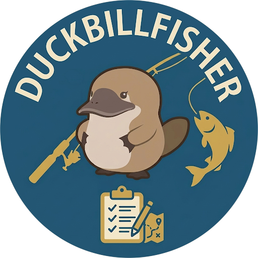

# DuckbillFisher



**Let Duckbill guide your next catch.**

A Dalamud big-fish hunting companion for **FFXIV on the Korean and global clients**. Find your next fish, keep track of your collection, and spend less time looking up conditions.

## Features

- Browse fish with game icons, search, collection filters, regions, grades, and saved filter presets.
- Check baits, mooch chains, time/weather conditions, and availability up to 30 real days ahead. Switch Fish Eyes forecasts and inspect expandable Intuition calculations. Open fishing spots directly on the map.
- Prepare first baits for favorites or the full filtered list, with inventory counts and unresolved fish listed separately. Find owned baits with page markers and highlights in the game's bait UI; change pages and select baits yourself.
- Track favorites with local chat alerts, game sound effects, or a custom local WAV with preview controls.
- Use the quick list for fish available now or coming up soon.
- Follow your casts with a timer, bait snapshots, and character-specific fishing records.
- Track Intuition preparation, record big-fish attempts by appearance, and check unused carried baits.
- Open fish details with `/dbfs fish name` or fish-item context menus; view available Double/Triple Hook yields.
- Read installer release notes and browse the latest ten releases in Korean or English from Settings → What's new.

Korean and English interface options are available. Fish, item, and location names come from your game client. Collection status is confirmed against the game fish guide; unread data stays unknown, and manual overrides take priority.

## Install

Add this URL to Dalamud's custom plugin repositories, then install **DuckbillFisher** from the plugin installer:

```text
https://raw.githubusercontent.com/PlatyDuckbill/DuckbillRepo/main/pluginmaster.json
```

The shared repository provides **DuckbillFisher and DuckbillTweak**, installed and updated separately. The old individual repository URLs have been retired. Remove those repository entries and add the shared URL above.

To change an existing plugin's installation source, disable it, **remove only the plugin**, and install it once from the shared repository. **Do not delete or reset plugin configuration or data.** See the [migration steps](https://github.com/PlatyDuckbill/DuckbillRepo#기존-개별-저장소에서-전환).

Open with `/dbfs` or `/duckbillfisher`. Use `/dbfs cl` for the compact list and `/dbfs ct` for the casting timer; the full `compact` and `timer` arguments also work with either command. The same repository supplies future updates through Dalamud. No source build or manual DLL registration is required for normal installation.

[한국어 설치·배포 안내](docs/development/DISTRIBUTION.md)

## Supported environment and limits

- Current release: **[0.8.0.0](https://github.com/PlatyDuckbill/DuckbillFisher/releases/tag/v0.8.0.0)**, built for **Dalamud API 15**. It adds Intuition preparation, automatic appearance attempts, and fish detail shortcuts. See the [release notes](docs/releases/0.8.0.0.md).
- Supported clients: the Korean client with KR Dalamud (wasdcxz or dal4kr) and the global client with Dalamud. Representative checks were done on Korean client 2026.10.06 and global client 2026.10.16.
- Game features use the structures provided by the running Dalamud, so Dalamud updates do not need a plugin release. Each feature checks what it reads; if a game patch changes it, only that feature turns off and manual settings are kept.
- Forecasts model time/weather and Intuition preparation opportunities. They do not establish the character's actual catches or active Intuition buff and do not guarantee a catch. Unknown Intuition durations use a marked 175-second assumption. Some conditions, ocean fishing, and spearfishing have incomplete coverage.
- Casting records cover observed rod-fishing events. Unconfirmed results remain unknown; special outcomes and multiple catches need further observation.
- No automatic casting, hooking, movement, bait changes, or server chat messages. Alerts are local. No external HTTP requests run inside the plugin.

See [current verification scope](docs/STATUS.md) and the [remaining roadmap](docs/product/ROADMAP.md).

## Data and acknowledgements

Fishing conditions are derived from a pinned revision of [FFX|V Fish Tracker App](https://github.com/icykoneko/ff14-fish-tracker-app), under its MIT license. Names, icons, maps, and weather rates are read from the installed game client. See [data provenance](data/README.md) and [third-party notices](THIRD-PARTY-NOTICES.txt); the notices are also embedded in the plugin.

## License

DuckbillFisher is licensed under the [GNU Affero General Public License v3.0](LICENSE). Bundled third-party data keeps its own license; see [third-party notices](THIRD-PARTY-NOTICES.txt).

## Development

Start with the [documentation map](docs/README.md). Repository skills live in [.agents/skills](.agents/skills) and share the maintained build and native compatibility procedures.

Windows, PowerShell 7, .NET SDK **10.0.101 or later in the 10.0 band** (10.0.402 on the main development PC), and KR or global Dalamud references are used for development. `global.json` sets the SDK floor to match the official build container, and lock files pin dependencies.

Initialize the current PowerShell session with `. ./scripts/enter-dev.ps1`. It sets the checkout root and `DALAMUD_HOME`; use `-DalamudPath` for a different reference distribution. See [environment setup](docs/development/WINDOWS-SETUP.md#개발-환경-변수). Building against KR and global references checks compilation only; in-game behavior is checked separately.

Follow [workflow](docs/development/WORKFLOW.md) for direct builds and resource checks, [distribution](docs/development/DISTRIBUTION.md) for packaging and publication, and [session handoff](docs/SESSION-HANDOFF.md) for current machine paths. Tests run only when explicitly requested. Contribution boundaries are in [AGENTS.md](AGENTS.md).

Source files are grouped by feature inside Core and Plugin. The managed test suite covers forecasts, alert scheduling, cast state, settings policies, data validation, and local history storage without a game installation. See [architecture](docs/development/ARCHITECTURE.md) and [test scope](docs/verification/ARCHITECTURE-TESTS.md); native observations and in-game UI still require separate checks.
