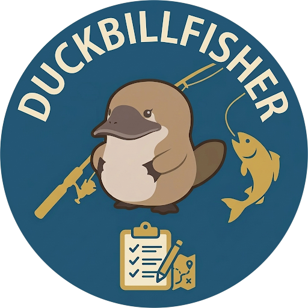

# DuckbillFisher



**Let Duckbill guide your next catch.**

A Dalamud fishing companion for **FFXIV Korea**. Find your next fish, keep track of your collection, and spend less time looking up conditions.

## Features

- Browse fish with game icons, search, collection filters, regions, grades, and saved filter presets.
- Check baits, mooch chains, time/weather conditions, and upcoming availability. Open fishing spots directly on the map.
- Prepare first baits for favorites or the full filtered list, with inventory counts and unresolved fish listed separately. Find owned baits with page markers and highlights in the game's bait UI; change pages and select baits yourself.
- Track favorites with local chat alerts and optional sound effects.
- Use the quick list for fish available now or coming up soon.
- Follow your casts with a timer, bait snapshots, and character-specific fishing records.

Korean and English interface options are available. Fish, item, and location names come from your game client. Collection status is confirmed against the game fish guide; unread data stays unknown, and manual overrides take priority.

## Install

Add this URL to Dalamud's custom plugin repositories, then install **DuckbillFisher** from the plugin installer:

```text
https://raw.githubusercontent.com/PlatyDuckbill/DuckbillFisher/main/repo/pluginmaster.json
```

Open with `/duckbillfisher`. The same repository supplies future updates through Dalamud. No source build or manual DLL registration is required for normal installation.

[한국어 설치·배포 안내](docs/development/DISTRIBUTION.md)

## Supported environment and limits

- Current release: **[0.3.0.0](https://github.com/PlatyDuckbill/DuckbillFisher/releases/tag/v0.3.0.0)**, built for **Dalamud API 15**. Bait preparation and manual bait-finding guidance are included; representative checks of the extracted Release package passed on the developer's KR installation.
- Representative game checks use Korean client **2026.10.06.0000.0000** and **XIVLauncherKR Dalamud 15.0.3.6**. Other regional clients are not verified.
- Version 0.2.6.0 supports the inspected **wasdcxz and dal4kr builds of KR Dalamud 15.0.3.7**. These distributions share a version number but have distinct module identities. Representative checks of fish-guide opening, collection sync, and the casting timer passed on both the local PC and the friend's dal4kr installation after updating.
- Native observations require the inspected KR game and DLL versions. A patch can disable these features until compatibility is reviewed.
- Forecasts describe ordinary time/weather conditions. They do not confirm personal prerequisites or guarantee a catch. Some conditions, ocean fishing, and spearfishing have incomplete coverage.
- Casting records cover observed rod-fishing events. Unconfirmed results remain unknown; special outcomes and multiple catches need further observation.
- No automatic casting, hooking, movement, bait changes, or server chat messages. Alerts are local. No external HTTP requests run inside the plugin.

See [current verification scope](docs/STATUS.md) and the [remaining roadmap](docs/product/ROADMAP.md).

## Data and acknowledgements

Fishing conditions are derived from a pinned revision of [FFX|V Fish Tracker App](https://github.com/icykoneko/ff14-fish-tracker-app), under its MIT license. Names, icons, maps, and weather rates are read from the installed game client. See [data provenance](data/README.md) and [third-party notices](THIRD-PARTY-NOTICES.txt); the notices are also embedded in the plugin.

## Development

Start with the [documentation map](docs/README.md). Repository skills live in [.agents/skills](.agents/skills) and share the maintained build and KR compatibility procedures.

Windows, PowerShell 7, .NET SDK **10.0.402**, and the supported KR Dalamud references are used for development. Dependencies are pinned by `global.json` and lock files.

Follow [workflow](docs/development/WORKFLOW.md) for direct builds and resource checks, [distribution](docs/development/DISTRIBUTION.md) for packaging and publication, and [session handoff](docs/SESSION-HANDOFF.md) for current machine paths. Tests run only when explicitly requested. Contribution boundaries are in [AGENTS.md](AGENTS.md).
